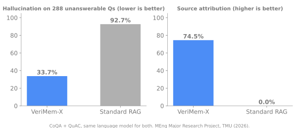

# VeriMem-X: Trustworthy Conversational QA

**MEng Major Research Project, Toronto Metropolitan University (2026)**

## The problem
Large language models answer fluently, but they often make things up, rarely show where an answer came from, and answer even when the information simply is not there. In customer-facing or high-stakes settings, a confident wrong answer is worse than no answer.

## What VeriMem-X does
A conversational question-answering system that answers only when its sources support the answer, points to the exact sentence it relied on, and says "I don't know" when the evidence is not there.

## Results

Compared against standard retrieval-augmented generation (RAG) on the same open-source language model, on the CoQA and QuAC conversational benchmarks:

| Metric | VeriMem-X | Standard RAG |
|---|---|---|
| Hallucination on 288 unanswerable questions | **33.7%** | 92.7% |
| Source attribution | **74.5%** | 0% |
| QuAC F1 | **0.179** | 0.081 (p < 0.001) |

- An independent judge model, separate from the system, confirmed the hallucination reduction (35.7%).
- Answer accuracy on answerable questions did not drop. **The trust features came at no measurable accuracy cost.**
- Results were checked against four alternative methods with confidence intervals and significance tests.

## Skills shown
LLMs, retrieval-augmented generation, hallucination reduction, source attribution, evaluation design, statistical testing

## Tech
Python, PyTorch, HuggingFace Transformers, vector search

## Code availability
This is an overview page. The implementation, methods and experiment details are part of my private research and are not published here. I am happy to discuss the project in an interview.

## Contact
Deepu Sasi | deepusasi.ai@gmail.com | [LinkedIn](https://www.linkedin.com/in/deepu-sasi)

---
[More projects on my GitHub profile](https://github.com/Deepu-Sasi)
